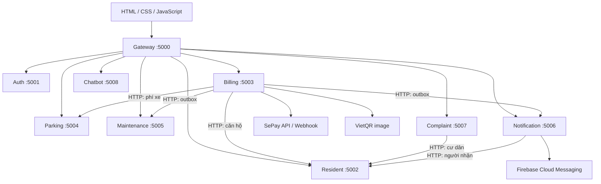
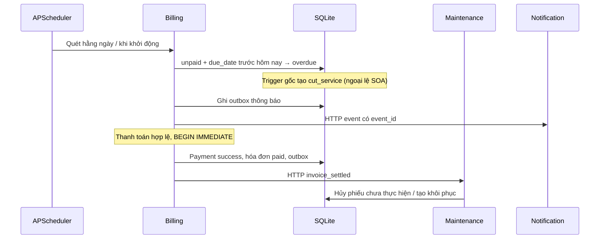

# Kiến trúc và phân tích nghiệp vụ

## Luồng triển khai

Lệnh MoMo cũ chỉ còn là dữ liệu lịch sử; không dùng để tạo hoặc xác minh thanh toán mới. Mỗi service là Flask app độc lập, có health endpoint, OpenAPI, cấu hình cổng và Dockerfile riêng. `shared/` chỉ có hạ tầng: SQLite connection, xác thực, HTTP client, validation, chuẩn lỗi. Giao tiếp nghiệp vụ giữa service là HTTP thật; gateway không đọc dữ liệu nghiệp vụ.

## Quyền sở hữu dữ liệu

| Service | Bảng / view sở hữu |
|---|---|
| Auth | users |
| Resident | apartments, residents, apartment_contracts, vw_apartment_overview |
| Billing | monthly_invoices/payments, semiannual_invoices/payments, bank_payment_intents, bank_transactions, bank_transaction_aliases, bank_transaction_resolutions, billing_payment_keys, billing_outbox, các view billing/revenue/overdue |
| Parking | vehicles, guest_parking_daily, vw_vehicle_summary_by_apartment, vw_guest_parking_monthly |
| Maintenance | technicians, maintenance_tickets, maintenance_events, cut_service_resolutions |
| Notification | notifications, notification_logs, notification_events, notification_audience, notification_push_tokens, notification_push_roles |
| Complaint | complaints |
| Chatbot | faq_knowledge_base, locations |

ID liên service là logical reference, được kiểm tra qua API khi tạo dữ liệu. Trong service dùng JOIN và FK vật lý. Dữ liệu của SQLite gốc được copy, không tạo lại thủ công để tránh mất trigger/view. `schema_migrations` thuộc công cụ triển khai, không phải một service nghiệp vụ thứ chín.

## Các bước đã thực hiện

1. Đọc yêu cầu và khảo sát bảng, view, trigger, dữ liệu mẫu. Xác định thiếu diện tích, mật khẩu giả và các liên kết user trùng trong mẫu.
2. Xây dựng kết nối SQLite có FK, timeout và chế độ WAL; migration và sao chép DB idempotent; secrets ngẫu nhiên.
3. Auth đăng nhập/đăng ký/JWT/phân quyền; Resident quản lý căn hộ, hồ sơ, lịch sử hợp đồng và hiệu lực sử dụng.
4. Parking và Billing tính phí, hóa đơn tháng/sáu tháng, báo cáo; thanh toán VietQR/SePay với Test Mode và Live; biên nhận.
5. Maintenance, Notification, Complaint, Chatbot; gắn scope người dùng vào dữ liệu nghiệp vụ.
6. APScheduler và outbox cho quá hạn, nhắc hạn, thông báo, khôi phục dịch vụ.
7. Giao diện tiếng Việt cho ba vai trò; gateway cùng origin; Docker Compose và runner Windows.
8. Pytest cho tính tiền, phân quyền, concurrency, callback và tích hợp HTTP; kiểm tra giao diện và tài liệu demo.

## Thanh toán và quá hạn

Outbox lưu trong cùng transaction với thay đổi thanh toán, giao lại khi service đích mất kết nối. Đích lưu `event_id` để xử lý một lần. Retry không tự lặp mutation không có khóa chống trùng. Kiểm tra thanh toán và ghi dữ liệu được tuần tự hóa để callback đồng thời không nhân đôi biên nhận.

Phiếu cắt đã bắt đầu có thể đã tác động thực tế nên khi đủ điều kiện sẽ tạo phiếu khôi phục. Phiếu còn chờ sẽ được đóng với kết quả `cancelled`. Trạng thái nghiệp vụ này nằm trong bảng bổ sung vì enum trạng thái gốc không có `cancelled`.

## Quy tắc và quyền chính

| Quy tắc | Kiểm tra tại |
|---|---|
| Đăng ký công khai chỉ tạo cư dân | Auth |
| Cư dân chỉ xem hóa đơn/xe/phiếu/thông báo riêng của căn hộ đang có quyền ở | Mỗi domain gọi Resident |
| Chỉ quản trị xác nhận thu tiền mặt/chuyển khoản | Billing |
| Webhook SePay có API Key hợp lệ, đúng tài khoản/ngân hàng/chiều tiền; chống lặp và phân bổ tối đa số còn nợ | Billing |
| Kỹ thuật viên chỉ cập nhật trạng thái phiếu được giao | Maintenance |
| Số tiền là số nguyên VND không âm; không nhập float/boolean | Billing/Parking |
| Một hóa đơn mỗi căn hộ/mỗi kỳ/mỗi loại | SQLite unique + API |
| Một bản ghi doanh thu vãng lai mỗi ngày | SQLite unique + API |
| Mật khẩu băm, token có thời hạn; tài khoản bị khóa mất quyền ngay | Auth và middleware các service |

## Đánh đổi và hướng mở rộng

Một file DB giúp chạy demo dễ và giữ nguyên dữ liệu được cung cấp. Chưa có độc lập lưu trữ vật lý: khi đưa vào vận hành nhiều người dùng, cần tách DB, thay trigger chéo service, triển khai queue/event bus, distributed scheduler lock, backup và quan sát hệ thống. Một Billing replica hiện giữ APScheduler trong tiến trình; không tăng replica khi chưa có cơ chế khóa job.

Swagger UI dùng tài nguyên CDN; OpenAPI JSON vẫn truy cập được khi không có CDN. Waitress được chọn để chạy thống nhất trên Windows/Linux theo [tài liệu triển khai Flask](https://flask.palletsprojects.com/en/stable/deploying/waitress/).
